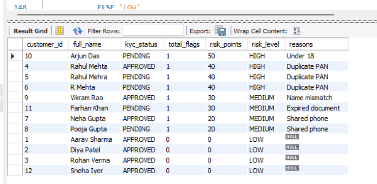

# KYC Red-Flag Checker (MySQL)

A simple SQL project that checks customer onboarding data for common KYC red flags
and rates each customer High / Medium / Low risk.

## Checks
1. Same PAN used by more than one customer
2. Same phone number shared across customers
3. Name on document doesn't match the application
4. Customer under 18
5. Document already expired when uploaded

## How it works
- Two tables: `customers` and `kyc_documents`
- Five SQL checks using GROUP BY / HAVING, JOINs and date functions
- A risk report (CTE + CASE) that adds up risk points per customer

## Result
On a 12-customer test set, it flagged 8 risky profiles, including an approved
account that shares its PAN with two other accounts.

## How to run
Open `kyc_check_simple.sql` in MySQL Workbench (MySQL 8+) and run it.

*All data is synthetic and created for learning purposes.*
